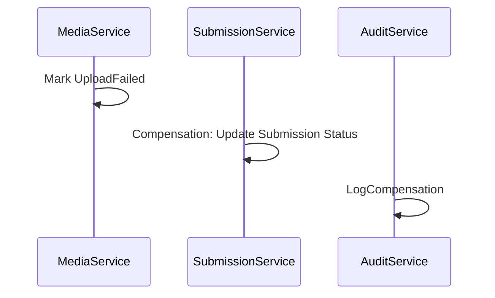
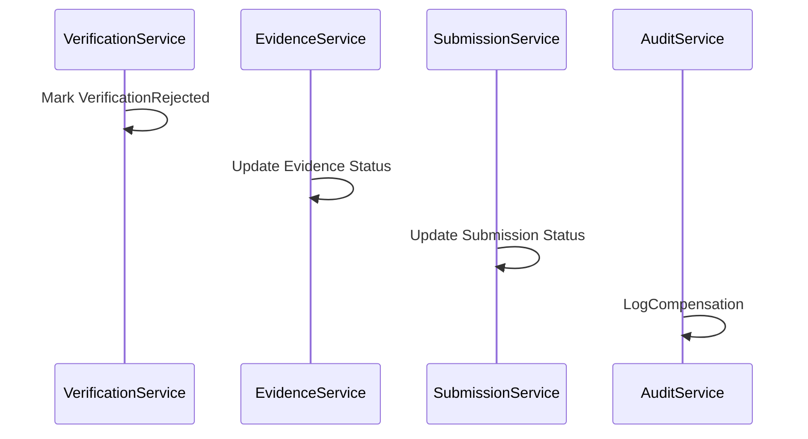
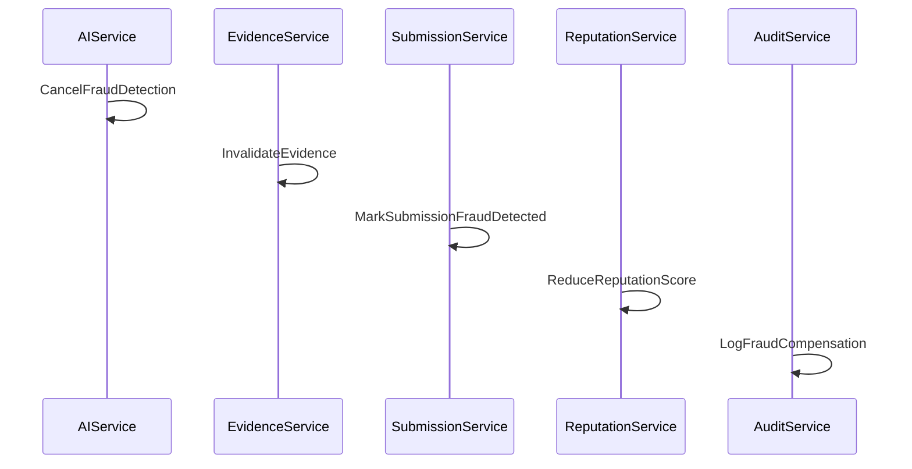
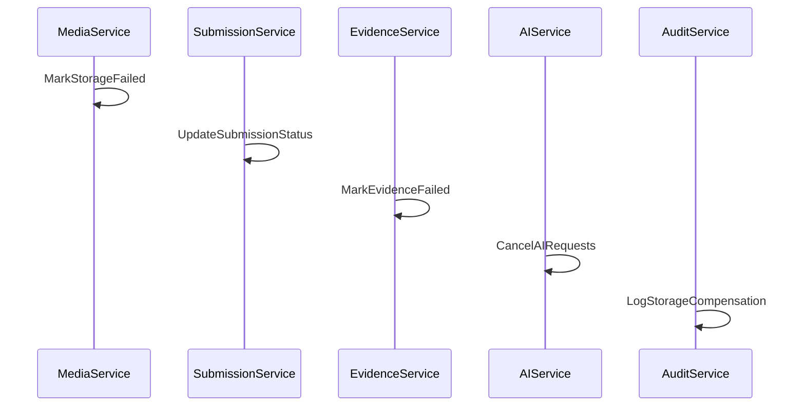
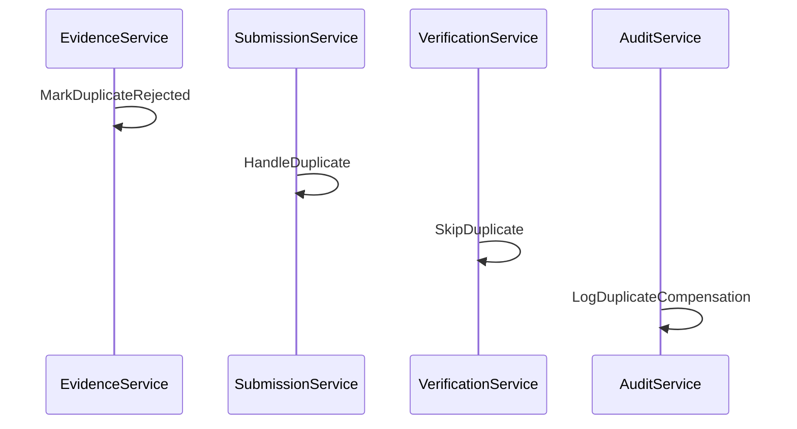
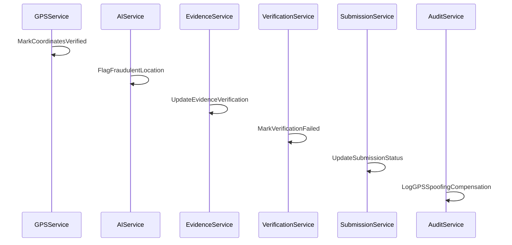

# Saga Design for Verification Domain

## Saga Overview

The Verification Domain utilizes distributed transactions across multiple microservices. Each service's actions must be compensated if an error occurs during the verification workflow. The Saga pattern ensures eventual consistency through compensating transactions.

## Compensating Actions

### 1. Upload Failed Compensation

**Initiation**: When MediaService fails to upload a file during submission creation

**Compensation Steps**:
1. MediaService: Mark media upload as failed and rollback storage
2. SubmissionService: Mark submission as upload_failed (compensate SubmissionCreated)
3. ReputationService: No compensation needed
4. AuditService: Log compensation

**Compensation Sequence**:

### 2. Verification Rejected Compensation

**Initiation**: When verification fails and EvidenceService verifies rejection status

**Compensation Steps**:
1. VerificationService: Mark verification as rejected and rollback changes
2. EvidenceService: Mark evidence as rejected (compensate EvidenceVerified)
3. AIService: No compensation needed
4. SubmissionService: Update submission status back to pending_verification
5. AuditService: Log compensation

**Compensation Sequence**:

### 3. Fraud Detected Compensation

**Initiation**: When fraud detection service identifies fraudulent evidence

**Compensation Steps**:
1. AIService: Cancel fraud detection and mark as cancelled
2. EvidenceService: Invalidate evidence and mark as fraud_detected
3. SubmissionService: Update submission status to fraud_detected
4. ReputationService: Reduce reputation score for user
5. AuditService: Log all compensation steps

**Compensation Sequence**:

### 4. Storage Unavailable Compensation

**Initiation**: When storage provider becomes unavailable during media upload

**Compensation Steps**:
1. MediaService: Mark failed uploads for retry
2. SubmissionService: Mark submission as storage_failed (compensate SubmissionCreated)
3. AIService: Cancel any AI processing requests on unavailable evidence
4. EvidenceService: Mark evidence as storage_failed
5. AuditService: Log compensation

**Compensation Sequence**:

### 5. Duplicate Evidence Compensation

**Initiation**: When duplicate evidence is detected

**Compensation Steps**:
1. EvidenceService: Mark duplicate as rejected
2. SubmissionService: Reject submission or skip duplicate
3. VerificationService: Skip duplicate evidence during verification
4. AuditService: Log duplicate detection and compensation

**Compensation Sequence**:

### 6. GPS Spoofing Compensation

**Initiation**: When GPS coordinates are detected as fraudulent

**Compensation Steps**:
1. GPSService: Mark coordinates as verified (no compensation needed)
2. AIService: Mark location data as fraudulent in AI results
3. EvidenceService: Update evidence verification status
4. VerificationService: Mark verification as failed due to invalid GPS
5. SubmissionService: Update submission status to requirements_failed
6. AuditService: Log spoofing detection and compensation

**Compensation Sequence**:

## Saga Execution Order

Based on dependencies, verification workflows execute in this order:

1. **EvidenceService** - Submits evidence and waits for verification
2. **GPSService** - Enables GPS when evidence requires location
3. **AIService** - Processes evidence content and runs verification
4. **VerificationService** - Coordinates overall verification process
5. **AuditService** - Logs all operations for compliance
6. **ReputationService** - Updates reputation scores

## Transaction Guidelines

- Each Saga step must be idempotent to allow retries
- Compensations must be logged for audit trail
- Saga orchestration should have timeout and circuit breaker patterns
- Each service's compensation must complete successfully before proceeding to next